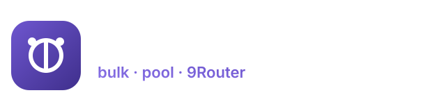

<div align="center">



### Bulk-create Ox Alpha sessions · pool them · serve OpenAI-compatible · wire into 9Router

[](https://nodejs.org)
[](package.json)
[](LICENSE)
[](https://9router.com)
[](https://oxalpha.com/chat)
[](src/browser.js)
[](#verification)

[English](README.md) ·
[Indonesia](i18n/README.id.md) ·
[中文](i18n/README.zh.md) ·
[日本語](i18n/README.ja.md) ·
[Español](i18n/README.es.md)

</div>

---

## What this is

**Ox Alpha** is a free "stealth reasoning" chat at
[oxalpha.com/chat](https://oxalpha.com/chat) — no signup, no API key. It serves
exactly one model:

| Upstream id | Display name | Context | Notes |
| --- | --- | --- | --- |
| `z-ai/glm-5.3-flash` | **Ox Alpha** (slug `ox-alpha`) | 1M tokens (claimed) | SSE, reasoning enabled. Routed via Parasail / CoreWeave / DigitalOcean. |

Any other model id returns `422 Invalid model`.

This toolkit:

1. **Bulk-creates** Ox Alpha anonymous sessions — one isolated browser context
   per account, so cookies never overlap.
2. **Pools** them (round-robin + automatic failover) so the aggregate free
   quota scales with the number of sessions.
3. **Serves** an OpenAI-compatible API (`/v1/chat/completions`, `/v1/models`).
4. **Registers** itself into [9Router](https://9router.com) as an
   `openai-compatible` provider.

Zero npm dependencies. Pure Node ≥ 18. One Chromium.

## Why a browser is required

Ox Alpha ties the anonymous session **and** a Cloudflare Turnstile checkpoint to
the client IP. The same cookies that work in a real browser return
`HTTP 428 {"code":"turnstile_required"}` from a datacenter host. So every
request is relayed from **inside a live `oxalpha.com` page**, riding the
browser's egress IP, cookie jar and TLS fingerprint.

- **Local Chromium** (default): `CHROME_PATH=/usr/bin/chromium`.
- **Remote Chromium / cloud browser**: `CDP_URL=wss://…/devtools/browser/<id>`.

## Quick start

```bash
# 0. a browser is required
export CHROME_PATH=/usr/bin/chromium        # or: export CDP_URL=wss://…

# 1. (optional) copy the config template
cp config.example.json config.json

# 2. bulk-create 5 sessions -> accounts.json
./run.sh create --count 5 --concurrency 2

# 3. inspect the pool
./run.sh list

# 4. run the OpenAI-compatible pool adapter (default :8790)
./run.sh adapter

# 5. register it into 9Router (local :20128 or https://9router.com)
ROUTER_URL=http://127.0.0.1:20128 ROUTER_PASSWORD=123456 ./run.sh connect
```

Then use it like any OpenAI provider:

```bash
curl http://127.0.0.1:8790/v1/chat/completions \
  -H "Content-Type: application/json" \
  -d '{"model":"oxalpha/z-ai/glm-5.3-flash",
       "messages":[{"role":"user","content":"hello"}]}'
```

…or through 9Router:

```bash
curl http://127.0.0.1:20128/v1/chat/completions \
  -H "Authorization: Bearer sk-…" -H "Content-Type: application/json" \
  -d '{"model":"oxalpha/z-ai/glm-5.3-flash",
       "messages":[{"role":"user","content":"hello"}]}'
```

## CLI

| Command | Description |
| --- | --- |
| `node src/cli.js create --count N [--concurrency K]` | Harvest N sessions into `accounts.json` |
| `node src/cli.js list` | Show pool size, per-session usage/remaining |
| `node src/cli.js adapter` | Run the OpenAI-compatible pool adapter |
| `node src/cli.js connect` | Register the adapter into 9Router |
| `node src/cli.js test "hello"` | One-off chat through a fresh session |

## Adapter endpoints

| Method | Path | Description |
| --- | --- | --- |
| `POST` | `/v1/chat/completions` | Chat (stream + non-stream) |
| `GET` | `/v1/models` | `oxalpha/z-ai/glm-5.3-flash` |
| `GET` | `/health` | Status + pool stats |
| `GET` | `/pool` | Per-session usage / remaining / health |
| `POST` | `/pool/reload` | Re-hydrate from `accounts.json` |

## Configuration

`config.json` (see `config.example.json`):

| Key | Default | Meaning |
| --- | --- | --- |
| `modelPrefix` | `oxalpha` | Model prefix in 9Router |
| `port` / `host` | `8790` / `127.0.0.1` | Adapter bind |
| `accountsFile` | `accounts.json` | Session store |
| `concurrency` | `2` | Parallel harvest workers |
| `headless` | `true` | Headless Chromium |
| `cdpUrl` / `chromePath` | `null` | Transport override |

Environment variables win over the file:
`CDP_URL`, `CHROME_PATH`, `ROUTER_URL`, `ROUTER_PASSWORD`, `PORT`, `HOST`,
`OXALPHA_PREFIX`, `OXALPHA_ACCOUNTS`.

## Verification

Tested end to end against a running 9Router (v0.5.99):

```
pool ready: 3/3 healthy, 3 live
router models: ["oxalpha/z-ai/glm-5.3-flash"]
router non-stream: 200  content "…"
router SSE: 200  "X Y Z"  → data: [DONE]
```

`accounts.json` is a live secret store — it is **git-ignored**.

## Project layout

See [STRUCTURE.md](STRUCTURE.md) for the full diagram.
Wire details live in [docs/PROTOCOL.md](docs/PROTOCOL.md).

## License

MIT — see [LICENSE](LICENSE).
